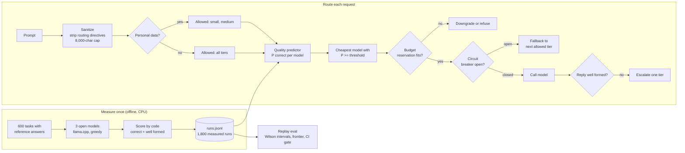

# Cost-aware LLM router

Send each prompt to the cheapest model that is likely to answer it well. The router learns from
measured answers by three small open models, and it comes with budget caps, fallback, escalation and
data-residency guardrails. Every number is from a replay of real, measured model runs.

## Recruiter summary

- **Problem:** the operations team at a fictional logistics firm, Lumenfield Freight, sends every
  request to its biggest model. Most requests are simple, so most of that spend is wasted. Requests
  that hold customer contact details must also stay on the in-house (small and medium) tiers.
- **Approach:** 600 synthetic logistics tasks in 6 families, each with a reference answer. Three open
  models (0.5B, 1.5B, 3.8B) answered every task on CPU and were scored by code. One logistic-regression
  quality predictor per model estimates "will this model get it right?". The router then takes the
  cheapest model that clears a threshold chosen on validation data. Around it sit escalation on
  malformed replies, a budget cap that reserves spend before each call, a circuit breaker with
  fallback, prompt-injection stripping and a residency rule.
- **Proof (measured on 120 held-out tasks, synthetic data):** the router scores **70.0%**<!-- m:policies/router+escalation/accuracy/rate -->
  correct vs 65.0%<!-- m:policies/always:phi-3.5-mini/accuracy/rate --> for "always the large model", at
  **31.9%**<!-- m:vs_always_large/cost_ratio --> of the cost and a p95 latency of 1.516 s<!-- m:policies/router+escalation/latency_p95_s -->
  instead of 5.308 s<!-- m:policies/always:phi-3.5-mini/latency_p95_s -->. The confidence intervals overlap, so the
  honest claim is "same quality, about a third of the cost". 0<!-- m:guardrails/residency_violations --> residency
  violations, 0<!-- m:guardrails/budget_overruns --> budget overruns. <!-- tests -->74<!-- /tests --> tests, CI green.

## Purpose and who it is for

- **Platform and FinOps teams** who pay for LLM calls and want a measured way to spend less.
- **ML engineers** who want a small, honest routing baseline with a replayable evaluation.
- **Architects** who need cost controls and data rules that are code with tests, not a slide.

It is a reference build on synthetic tasks with small models. It does not prove anything about
large hosted models or open-ended requests.

## Architecture



## How it works, step by step

1. **Tasks.** `costroute/tasks.py` builds 600 tasks: ID extraction, intent labels, one-step and two-step
   arithmetic, JSON extraction and date arithmetic, 100 of each. 42 hold fake customer e-mails or phone
   numbers. A hash splits them 351 / 129 / 120 into train / validation / test.
2. **Measure.** `scripts/run_models.py` ran all three models on every task on an 8-core CPU (greedy,
   up to 80 tokens), about 28 minutes in total. Each run stores the reply, tokens and seconds.
3. **Label.** `costroute/scoring.py` compares each reply to the reference answer. No LLM judge.
4. **Cost.** Measured seconds times the hourly price of the VM the model would run on
   (Standard_D8s_v5, $0.384 per hour, Azure retail price on 2026-11-09). See [ADR 0004](docs/adr/0004-cost-from-measured-seconds.md).
5. **Predict.** One logistic regression per model on word and character TF-IDF plus prompt-shape
   features predicts "this model will be correct". Test AUC: 0.9735<!-- m:predictor/qwen2.5-0.5b/auc -->,
   0.9868<!-- m:predictor/qwen2.5-1.5b/auc -->, 0.9313<!-- m:predictor/phi-3.5-mini/auc -->.
6. **Pick.** Take the cheapest allowed model with predicted quality at or above the threshold. The
   threshold, 0.8<!-- m:threshold/chosen -->, is the cheapest setting within 2 points of always-large on
   validation. If no model clears it, use the largest allowed, unless every model is below 0.15: then a
   bigger model will not help, so use the cheapest and flag the request.
7. **Serve.** Escalate one tier if the reply is malformed; respect the budget and the circuit breaker.
8. **Evaluate.** `scripts/run_eval.py` replays the measured runs for every policy, so the comparison is
   exact. CI fails if the router stops beating random, costs more than always-large, or breaks a guardrail.

## Results (measured runs, synthetic tasks)

Full tables with Wilson 95% intervals, the per-family breakdown and the cost/quality frontier:
[results/report.md](results/report.md).

<!-- run: python scripts/run_eval.py --summary -->
```text
test tasks: 120
always:qwen2.5-0.5b: accuracy 0.467, $0.0295 per 1k, p95 0.529 s
always:phi-3.5-mini: accuracy 0.650, $0.2041 per 1k, p95 5.308 s
router+escalation: accuracy 0.700, $0.0650 per 1k, p95 1.516 s
oracle: accuracy 0.717, $0.0434 per 1k, p95 1.292 s
router cost vs always-large: 0.319
budget 50%: served 1.000, within cap True
outage served: no fallback 0.775, breaker 1.000
guardrails: residency violations 0, injection route changes 0, budget overruns 0
```
<!-- /run -->

| Policy (test, 120 tasks) | Accuracy (95% CI) | $ per 1k requests | p95 latency |
|---|---|---|---|
| Always small (qwen2.5-0.5b) | 46.7%<!-- m:policies/always:qwen2.5-0.5b/accuracy/rate --> | $0.02955<!-- m:policies/always:qwen2.5-0.5b/usd_per_1k --> | 0.529 s |
| Always medium (qwen2.5-1.5b) | 61.7%<!-- m:policies/always:qwen2.5-1.5b/accuracy/rate --> | $0.05509<!-- m:policies/always:qwen2.5-1.5b/usd_per_1k --> | 1.153 s |
| Always large (phi-3.5-mini) | 65.0% (56.1-73.0%) | $0.20411<!-- m:policies/always:phi-3.5-mini/usd_per_1k --> | 5.308 s |
| Random tier | 58.3%<!-- m:policies/random/accuracy/rate --> | $0.10757 | 3.822 s |
| **Router + escalation** | **70.0% (61.3-77.5%)** | **$0.06503**<!-- m:policies/router+escalation/usd_per_1k --> | **1.516 s** |
| Oracle (cheapest correct, upper bound) | 71.7%<!-- m:policies/oracle/accuracy/rate --> | $0.04342<!-- m:policies/oracle/usd_per_1k --> | 1.292 s |

What the numbers say, in plain words:

- **Bigger is not always better.** The large model gets JSON extraction right 15 of 20 times (it
  misspells city names); both small models get 20 of 20. The router sends those tasks to the small tier.
- **The router mostly knows its limits.** It sends date arithmetic to the large model and matches it
  (12 of 25). Paired on the same tasks, the router is right where large was wrong 8<!-- m:vs_always_large/router_right_large_wrong -->
  times and wrong where large was right 2<!-- m:vs_always_large/router_wrong_large_right --> times.
- **Budget caps work by reserving spend first.** At 50% of always-large spend all requests are served.
  At 10% the router downgrades 13 and refuses 54<!-- m:budget_tight/refused --> requests, and still stays under the cap.
- **Fallback matters in an outage.** With the medium tier down for 50 requests, no fallback serves
  77.5%<!-- m:outage/no_fallback/served/rate -->; the circuit breaker serves 100.0%<!-- m:outage/breaker_fallback/served/rate -->.

## Real code and its real output

The routing rule (`costroute/router.py`):

```python
for m in allowed:
    if probs[m] >= threshold:
        return m
if max(probs[m] for m in allowed) < hopeless:
    return allowed[0]
return allowed[-1]
```

Five requests through the full router:

<!-- run: python examples/route_demo.py -->
```text
[easy extraction] -> qwen2.5-0.5b (small)
  predicted quality: qwen2.5-0.5b 0.98, qwen2.5-1.5b 0.99, phi-3.5-mini 0.99; threshold 0.8
  if the reply is malformed, escalate to: qwen2.5-1.5b, phi-3.5-mini
[two-step arithmetic] -> qwen2.5-0.5b (small)
  predicted quality: qwen2.5-0.5b 0.03, qwen2.5-1.5b 0.03, phi-3.5-mini 0.05; threshold 0.8
  low confidence on every tier: cheapest tier used, flag for a tool or a person
  if the reply is malformed, escalate to: qwen2.5-1.5b, phi-3.5-mini
[date arithmetic] -> phi-3.5-mini (large)
  predicted quality: qwen2.5-0.5b 0.02, qwen2.5-1.5b 0.16, phi-3.5-mini 0.56; threshold 0.8
[personal data] -> qwen2.5-1.5b (medium)
  predicted quality: qwen2.5-0.5b 0.27, qwen2.5-1.5b 0.99, phi-3.5-mini 0.98; threshold 0.8
  personal data found: local tiers only -> qwen2.5-0.5b, qwen2.5-1.5b
[asks for the big model] -> qwen2.5-1.5b (medium)
  predicted quality: qwen2.5-0.5b 0.21, qwen2.5-1.5b 0.98, phi-3.5-mini 0.97; threshold 0.8
  note: removed a routing directive from the prompt
  if the reply is malformed, escalate to: phi-3.5-mini
```
<!-- /run -->

## How to run

Offline, no cloud, no model weights needed (the measured runs are committed):

```bash
python -m venv .venv && . .venv/bin/activate
pip install -r requirements.txt
python -m pytest -q                       # tests
python scripts/run_eval.py                # all metrics -> results/
python examples/route_demo.py             # five example requests
python -m costroute.service "How many boxes are on 4 pallets of 12? Answer with a number only."
```

Re-measure the runs (optional, about 3.9 GB of open weights, roughly 30 minutes on 8 CPU cores):

```bash
pip install llama-cpp-python==0.3.36
bash scripts/fetch_models.sh
python scripts/run_models.py
```

Optional cloud: a Microsoft Foundry / Azure ML managed online endpoint for the router, in Terraform and
Bicep, gated off. See [docs/deployment.md](docs/deployment.md) for the resources and a dated cost estimate.

## Guardrails and security controls

| Control | Where |
|---|---|
| Prompts with e-mails or phone numbers only go to the small and medium tiers | `guardrails.allowed_models` |
| "Use the biggest model" style directives are stripped before routing | `guardrails.sanitize` |
| Input capped at 8,000 characters; data errors never echo prompt text | `guardrails`, `data` |
| Budget reserves 1.5x the worst measured cost before each call; then downgrade or refuse | `guardrails.Budget`, `simulate.with_budget` |
| Circuit breaker opens after repeated failures and falls back to the next allowed tier | `guardrails.CircuitBreaker` |
| No pickle loading: the router retrains from the committed runs at start-up | `service.default_router`, `infra/aml/score.py` |
| Endpoint needs Entra ID tokens; deploy is OIDC, manual and gated | `infra/`, `.github/workflows/deploy.yml` |
| CI: ruff, tests, eval gate, docs drift, number check, brand check, gitleaks, CodeQL, IaC scans | `.github/workflows/` |

Threat model (STRIDE and OWASP LLM Top 10): [docs/threat-model.md](docs/threat-model.md).

## Limitations and known failures

- **Two-step arithmetic: 0 of 21 for every model**, so no routing can help. Test:
  `test_known_miss_no_tier_solves_two_step_arithmetic`. The fix is a calculator tool, not a bigger model.
- **The router loses some tasks the large model got right** (2 of 120). Test: `test_known_miss_router_loses_some_tasks_large_got_right`.
- **Escalation rarely fires** (2 of 120): a wrong answer in the right format passes the format check.
  Test: `test_known_miss_escalation_rarely_fires`.
- Accuracy intervals overlap between the router and always-large. 120 test tasks cannot separate them.
- Cost is CPU seconds on one VM type at full use. Hosted per-token prices, idle time and batching would
  change the ratios; `CostModel(utilisation=...)` lets you try that.
- Synthetic tasks with checkable answers, English, one domain, three small models. Open-ended requests
  would need a calibrated judge (Planned).

## Built vs planned

| Item | Status |
|---|---|
| 600 tasks with reference answers, code scoring | Built |
| Measured runs of 3 open models on CPU (1,800 runs) and the generator script | Built |
| Per-model quality predictor, threshold from validation, frontier | Built |
| Escalation, budget cap with reservation, circuit breaker, residency, directive stripping | Built |
| Replay eval with Wilson intervals, paired comparison, CI eval gate | Built |
| Router service, CLI and Azure ML scoring script (unit-tested offline) | Built |
| Terraform + Bicep for a Microsoft Foundry / Azure ML endpoint, deploy workflow | Written, not run (gated off) |
| Hosted per-token pricing tier, open-ended tasks with a calibrated judge | Planned |
| Online learning from production feedback, private networking | Planned |

## Docs

- [Data card](docs/data-card.md) and [model card](docs/model-card.md)
- [Implementation guide](docs/implementation-guide.md) for teams adopting this
- [Interview points](docs/interview-points.md)
- [Threat model](docs/threat-model.md), [deployment](docs/deployment.md), [ADRs](docs/adr/)

## Related repos

- [Jagadish-azure-finops](https://github.com/jagadishmazure-jpg/Jagadish-azure-finops): FinOps patterns, including routing as a cost lever; this repo measures one.
- [Jagadish-llm-capacity-planning](https://github.com/jagadishmazure-jpg/Jagadish-llm-capacity-planning): token-based capacity and cost planning.
- [Jagadish-local-model-agents](https://github.com/jagadishmazure-jpg/Jagadish-local-model-agents): local-first agents with fallback.
- [Jagadish-llm-evals-observability](https://github.com/jagadishmazure-jpg/Jagadish-llm-evals-observability): eval gates and tracing for LLM apps.
- [Jagadish-llm-provenance-classifier](https://github.com/jagadishmazure-jpg/Jagadish-llm-provenance-classifier): calibrated attribution with governance guardrails.

## License

MIT. Model replies come from Apache-2.0 and MIT models; weights are not included.
