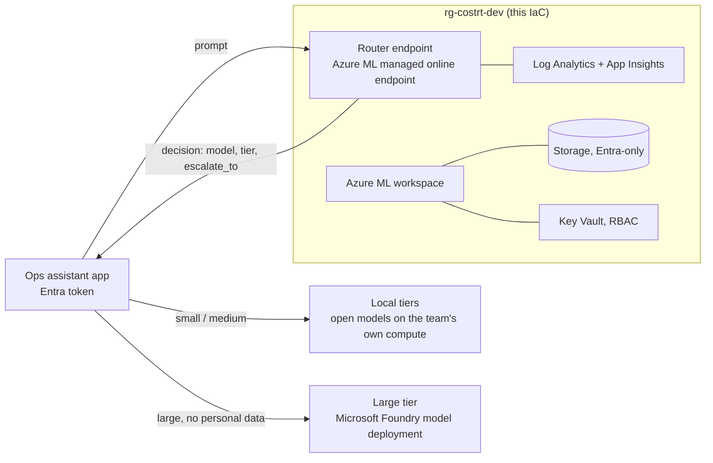

# Deployment to Microsoft Foundry / Azure ML (written, not run)

Nothing here has been deployed. The IaC is checked in CI (`terraform validate` and `test` with mocked
providers, `tflint`, `checkov`, `bicep build`), and the deploy workflow is switched off.

## Target design

The router endpoint returns a decision; the caller then calls that tier. The IaC creates the router's
hosting only. The large-tier model deployment in Microsoft Foundry is **not** created here: pick the
model in the Foundry catalog, deploy it, and give the app its endpoint. Personal-data prompts never go
there, whatever is deployed.

| Resource | Terraform | Bicep |
|---|---|---|
| Log Analytics + Application Insights | `azurerm_*` | same ARM types |
| Storage (TLS 1.2, no shared keys, no public blobs) | `azurerm_storage_account` | `Microsoft.Storage/storageAccounts` |
| Key Vault (RBAC, purge protection) | `azurerm_key_vault` | `Microsoft.KeyVault/vaults` |
| Azure ML workspace (identity access to storage) | `azapi_resource` (2025-06-01) | `workspaces@2025-06-01` |
| Managed online endpoint (`AADToken`) | `azapi_resource` | `onlineEndpoints@2025-06-01` |
| Diagnostic settings | `azurerm_monitor_diagnostic_setting` | `diagnosticSettings` |

`infra/aml/score.py` retrains the router from the committed data at start-up (no pickle) and is
unit-tested offline (`tests/test_service.py`).

## Cost before anyone says yes

Always-on cost is the router deployment VM: **Standard_DS2_v2, Linux, eastus2, $0.114 per hour**
(Azure Retail Prices API, pay-as-you-go, checked 2026-11-09), about **$83 for a 730-hour month**, plus
small Log Analytics, storage and Key Vault charges. The large-tier Foundry deployment is billed
separately and is not part of this IaC. Delete the resource group to stop charges. Check current prices
and get approval before enabling the workflow.

## One-time setup (only if approved)

1. Entra app registration with a federated credential for this repo's `dev` environment.
2. Contributor on one resource group or subscription.
3. Repository variables `AZURE_CLIENT_ID`, `AZURE_TENANT_ID`, `AZURE_SUBSCRIPTION_ID`.
4. A required reviewer on the `dev` environment.
5. `DEPLOY_ENABLED=true`, then run **deploy** by hand.

## Planned, not built

Private endpoints and a VNet, a prod stage, a teardown workflow, and wiring the app to a real Foundry
large-tier deployment.
